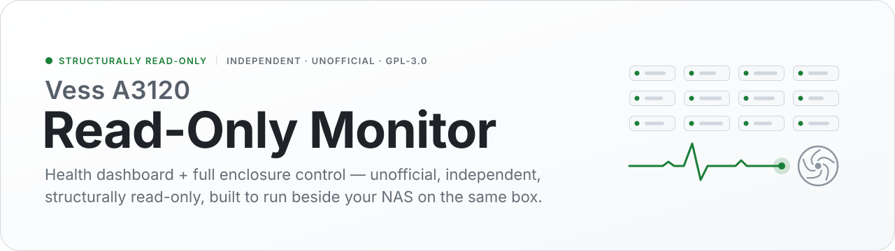
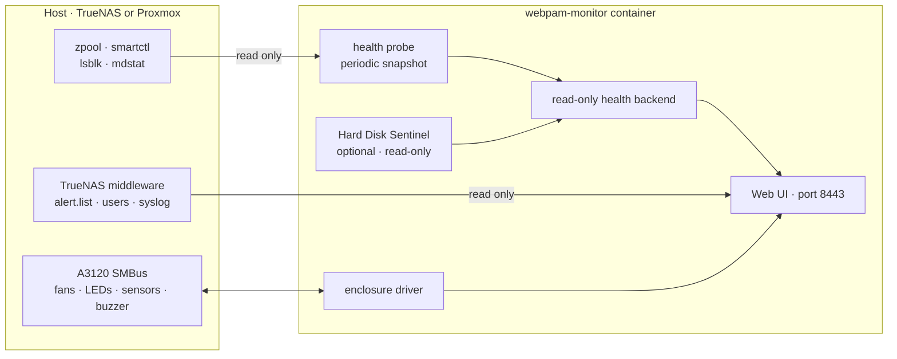

<div align="center">

<picture>
  <source media="(prefers-color-scheme: dark)" srcset="assets/banner-dark.svg">
  <source media="(prefers-color-scheme: light)" srcset="assets/banner-light.svg">
  
</picture>

<br>

<p>
  <a href="LICENSE"></a>
  
  
  <a href="https://github.com/CyborgFingers/vessapp-a3120-monitor/releases"></a>
  <a href="https://github.com/CyborgFingers/vessapp-a3120-monitor/pkgs/container/vessapp-a3120-monitor"></a>
  
</p>

<p>
  <a href="#-install-on-truenas--3-commands"><b>Install</b></a> ·
  <a href="#-what-you-get">Features</a> ·
  <a href="#-why-its-safe-on-a-live-nas">Why it's safe</a> ·
  <a href="#-how-it-works">How it works</a> ·
  <a href="#-using-it">Using it</a> ·
  <a href="#-configuration">Configuration</a> ·
  <a href="docs/TRUENAS.md">Full guide</a> ·
  <a href="#-legal--trademarks">Legal</a>
</p>

</div>

> [!IMPORTANT]
> **Independent, unofficial project — NOT affiliated with, endorsed by, or associated with Promise Technology, Inc.** See [Legal & Trademarks](#-legal--trademarks).

> [!NOTE]
> **Free software — GPL-3.0.** Use, study, modify, and redistribute under the [GNU General Public License v3.0](LICENSE). Provided with no warranty.

A drive / pool / SMART / temperature **health dashboard** with full **enclosure fan,
LED and buzzer control** for the **Promise Vess A3120**, designed to run safely
**alongside** TrueNAS or Proxmox on the same box. It reads the host's own `zpool` /
`smartctl` and drives the A3120 SMBus — and it **cannot touch your data**: there is
no create / delete / migrate / rebuild path anywhere in it. Not a hidden button —
the RAID write path simply does not exist in this codebase.

<br>

## 🚀 Install on TrueNAS — 3 commands

SSH into the NAS as an admin account and run:

```bash
git clone https://github.com/CyborgFingers/vessapp-a3120-monitor
cd vessapp-a3120-monitor
sudo bash port/packaging/truenas-setup.sh
```

That's it. The script **builds the image, deploys it as a managed Custom App, loads
the enclosure drivers, and turns on TrueNAS login** — it just asks for the admin
password. Then open **`https://<nas-ip>:8443/`** and sign in as `administrator`
(`:8088` redirects to HTTPS).

<details>
<summary><b>Other ways to install</b> — no <code>git</code>, paste YAML in the TrueNAS UI, Proxmox / Debian host, pre-built image</summary>

<br>

| Situation | Do this |
|---|---|
| **No `git` on the box** | Swap the first line for `curl -fsSL https://github.com/CyborgFingers/vessapp-a3120-monitor/archive/refs/heads/main.tar.gz \| tar xz && cd vessapp-a3120-monitor-main` |
| **Prefer the TrueNAS UI** | **Apps → Discover → Custom App → Install via YAML**, paste [`port/packaging/container/docker-compose.yml`](port/packaging/container/docker-compose.yml), set `WEBPAM_PASSWORD`, install. TrueNAS pulls the published image — **no build step**. |
| **Proxmox / Debian host** (no container) | `sudo bash port/packaging/install-webpam-monitor.sh` |
| **Non-interactive setup** | `sudo WEBPAM_PASSWORD=yourpw bash port/packaging/truenas-setup.sh` |
| **Pre-built container image** | `ghcr.io/cyborgfingers/vessapp-a3120-monitor` — published on each release tag; the in-app updater pulls new versions from here. |

Re-running the setup script is safe: an existing app is redeployed onto a fresh build.

</details>

**Full walkthrough: [`docs/TRUENAS.md`](docs/TRUENAS.md).**

<br>

## ✨ What you get

<table>
<tr>
<td width="50%" valign="top">

### 🩺 Monitor

- **Health dashboard — ZFS *and* mdadm/LVM.** Pools, arrays, logical & physical drives with SMART + temperature. Onboard/OS disks show as **Internal**, not in empty bays.
- **System hardware.** CPU **package + per-core** temps, **PCH/chipset** temp, **controller/board** temp. Voltage rails: **Vcore, AVCC, +3.3V, 3VSB** and the **CMOS battery (Vbat)**. CPU fan + chassis blowers, with empty-port **"Not Installed"** detection — no false alarms.
- **Per-drive Health %.** Normalised health score, temperature and power-on hours via **[Hard Disk Sentinel](https://www.hdsentinel.com)**, auto-installed from hdsentinel.com on first run (proprietary freeware — **not bundled**; see [Acknowledgements](#-acknowledgements)). Plus full `smartctl` identity on each drive page: **serial, firmware, interface** (e.g. SATA 3.3 / 6.0 Gb/s), **block size, capacity, SMART status**.

</td>
<td width="50%" valign="top">

### 🌀 Control & events

- **Full enclosure control.** CPU-fan and chassis-blower **fan curves with 1% granularity** + optional PWM→RPM calibration; front-panel **status LEDs** and **network LEDs**; the **fault buzzer**. *(Needs real A3120 hardware.)*
- **System Events.** One page merging **TrueNAS system alerts** (`alert.list`), the **enclosure sensor faults** WebPAM detects, **drive-health warnings**, and the **host syslog** — with **email on each new fault**.

</td>
</tr>
<tr>
<td width="50%" valign="top">

### 🔒 Safe & simple to run

- **Structurally read-only.** A dedicated health backend fills every view from a periodic **read-only snapshot** (`zpool` / `smartctl` / `lsblk` / `mdstat`). **No RAID write-helper is installed**, and the drive-management pages are nav-stripped and guarded.
- **Easy to deploy.** One command on TrueNAS, or paste the compose YAML in the Apps UI; Proxmox/Debian host script included; pre-built image on **GHCR** with no local build.
- **One-click updater.** Checks for new releases on login and updates **in place**, keeping your settings.

</td>
<td width="50%" valign="top">

### 🔗 Fits TrueNAS

- **Sign in with TrueNAS.** Members of the auto-created **`webpam` group** — and **any TrueNAS admin** — log in with their **TrueNAS password**. No separate account to manage.
- **Email relay.** Route TrueNAS's own alert emails through the SMTP server configured in WebPAM.
- **Your own TLS certificate.** **Administration → SSL / TLS Certificate**: install your server certificate + CA/intermediate chain (validated, nginx auto-reloads, auto-restores on failure), or regenerate the built-in self-signed cert — which includes the box's **IP in its SAN**.

</td>
</tr>
</table>

<br>

## 🔒 Why it's safe on a live NAS

| ✅ Reads — never writes | 🌀 Drives — enclosure only | 🚫 Does not exist in this codebase |
|---|---|---|
| `zpool` · `smartctl` · `lsblk` · `mdstat` · TrueNAS `alert.list` / users / syslog | Fans · status & network LEDs · fault buzzer — over the A3120 SMBus | create · delete · migrate · rebuild — no RAID write-helper, no privileged path to an array |

Read-only is **structural**, not just hidden buttons:

- A dedicated **health backend** fills every view from a periodic, read-only
  snapshot (`zpool` / `smartctl` / `lsblk` / `mdstat`) — it **never writes** to a disk.
- **No RAID write-helper is installed**, so the web tier has **no privileged path**
  to alter an array. Drive-management pages are additionally nav-stripped and guarded.
- There is **no create / delete / migrate / rebuild code path** in this project at all —
  nothing to misclick, nothing to exploit.
- The **enclosure** (fans / LEDs / temperatures / buzzer) stays fully functional on
  real A3120 hardware — that is the part you *want* to control.

<br>

## 🧭 How it works



The container reads the **host's own** `zpool` / `smartctl` (and `midclt` on
TrueNAS) by `nsenter`-ing into PID 1 — so tool versions always match the host and
no ZFS userland ships in the image. That is why the compose uses
`privileged: true` + `pid: host`; those privileges are used **only to read**.

<br>

## 🧰 Using it

| I want to… | Do this |
|---|---|
| **Log in** | As `administrator` (the password you set), or as any TrueNAS user in the `webpam` group / any TrueNAS admin, with their TrueNAS password. |
| **Add people** | TrueNAS → Credentials → Local Groups → `webpam` → Members. |
| **Update** | Click the banner that appears on login → **Update now**. |
| **Relay email** | WebPAM **Email** page → set your SMTP → tick *"route TrueNAS alerts through this SMTP server."* |
| **See events & alerts** | The **Events** page merges TrueNAS system alerts, the enclosure sensor faults WebPAM detects, drive-health warnings, and the host syslog; each new fault is emailed once your SMTP (above) is set. |
| **Fix the HTTPS warning** | Ships with a self-signed cert that includes the box's **IP in the SAN** (no name-mismatch error). To remove the browser warning for good, go to **Administration → SSL / TLS Certificate** and install your own server certificate + CA chain (e.g. from your internal PKI), or regenerate the self-signed one. Reaching WebPAM by a hostname? Set `WEBPAM_SAN="nas.lan"`. |
| **Roll back** | The prior image is kept as `webpam-monitor:stable-patched`. |
| **Uninstall** | TrueNAS → Apps → `webpam-monitor` → Delete (optionally remove the `webpam` group afterwards). |

See [`docs/TRUENAS.md`](docs/TRUENAS.md) for the full guide.

<br>

## 🔧 Configuration

Set these in the app's environment (the setup script and
[`docker-compose.yml`](port/packaging/container/docker-compose.yml) already set
the first three):

| Variable | Default | Purpose |
|---|---|---|
| `WEBPAM_PASSWORD` | *(prompted)* | First-run password for the built-in `administrator` login. |
| `VESSAPP_TRUENAS_SYNC` | `1` on TrueNAS | Mirror the TrueNAS `webpam` group (+ TrueNAS admins) into WebPAM login. Leave unset on a plain Docker host (no `midclt`). |
| `VESSAPP_HDSENTINEL` | `1` | Download Hard Disk Sentinel on first run for per-drive Health %. Set `0` to opt out — drive pages then use `smartctl` only. |
| `WEBPAM_SAN` | *(unset)* | Extra names/IPs for the self-signed certificate's SAN, e.g. `WEBPAM_SAN="192.0.2.10 nas.lan"`. |
| `HEALTH_REFRESH` | `60` | Seconds between host health snapshots. |

## 📋 Requirements

| | |
|---|---|
| **Host** | **TrueNAS SCALE 24.10 (Electric Eel) or newer** (Docker-based apps), or a Proxmox / Debian host. |
| **Hardware** | Enclosure fan/LED control needs real **A3120 hardware**; the health dashboard works anywhere. |

## 🔗 Related project

- **vessapp-a3120-linux** — the **full management** edition (create / delete /
  migrate / rebuild arrays). More capable, and correspondingly more dangerous.

<br>

## 📄 Legal & Trademarks

This project is **independent and unofficial**. It is **not** affiliated with,
authorized by, endorsed by, sponsored by, or associated with **Promise
Technology, Inc.** or any of its subsidiaries or affiliates. *"Promise"*,
*"Vess"*, *"WebPAM"*, *"A3120"*, and all related names and marks are trademarks
or registered trademarks of Promise Technology, Inc. and/or their respective
owners, and are used here **only** to identify the third-party hardware this
software interoperates with (nominative fair use). This project contains **no
Promise Technology source code**. All product and company names are the property
of their respective owners.

## 📜 License

**GNU General Public License v3.0** — © 2026 [CyborgFingers](https://github.com/CyborgFingers).
You may use, study, modify, and redistribute this software under the terms of the
[GPL-3.0](LICENSE). Distributed in the hope it will be useful, but **with no
warranty**.

The GPL covers copyright only and grants **no rights in any Promise Technology
name or trademark** — see [Legal & Trademarks](#-legal--trademarks).

## 🙏 Acknowledgements

Drive **Health %** scoring is provided by **[Hard Disk Sentinel](https://www.hdsentinel.com)**
© János Máthé — a separate, proprietary freeware tool. It is **not bundled** with
this GPL project; when enabled, the free Linux console build is downloaded from
hdsentinel.com into the app's own volume on first run, and WebPAM reads its
output. All credit for the health analysis belongs to Hard Disk Sentinel. If the
tool is absent, the drive pages fall back to native `smartctl` status.

<br>

<div align="center">
<sub>© 2026 CyborgFingers · GPL-3.0 · independent &amp; unofficial — see <a href="#-legal--trademarks">Legal &amp; Trademarks</a></sub>
</div>
